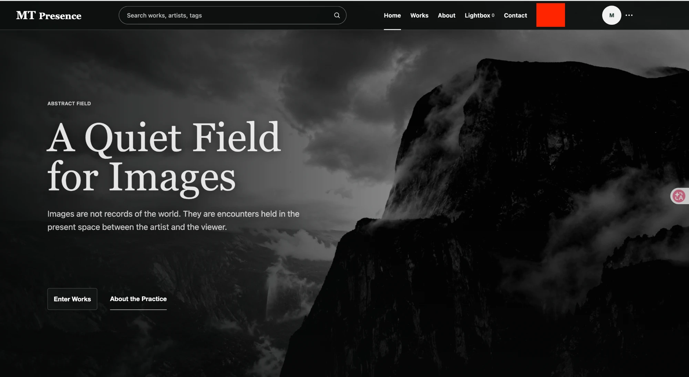

# 2026-10-15 老板对接需求记录

来源：与老板（摄影师）对接后的修改意见，由项目负责人转述。
状态说明：`待确认` 需要补充细节；`待开发` 需求已明确、尚未开始；`进行中`；`已完成`。

## 需求总览

| 编号 | 需求 | 优先级 | 状态 |
|---|---|---|---|
| 01 | 网站中英文切换 | 待定 | **已上线 v1.7.0**（2026-10-19；中文文案待老板审核） |
| 02 | 取消公开用户系统：访客无需登录，去掉个人主页 | 待定 | **已上线 v1.7.0**（2026-10-19） |
| 03 | 新建内容管理后台（指定账号登录，管理作品与网站展示内容） | 待定 | 部分完成，**已上线 v1.7.0**（2026-10-19；剩余见第 03 条「实施记录」） |
| 04 | 全站图片禁止下载（收藏功能暂时下线） | **必须** | 下载 / 收藏按钮已移除（v1.7.0）；禁止右键 / 拖拽 / 长按保存**已上线 v1.8.0**（2026-10-27） |
| 05 | 首页与 About 合并为一个页面 | 待定 | **已上线 v1.8.0**（2026-10-27）：About 并入首页，`/about.html` 已删除；板块顺序与导航「关于」先按默认方案，待老板确认 |
| 06 | 作品页改为「此间留彩 / 此间留灰」左右两张海报 | 待定 | **已上线 v1.8.0**（2026-10-27）：海报暂用各系列第一件作品自动排版 |
| 07 | 作品浏览（单张大图；手机全屏 / 大屏艺术馆场景；观赏与多功能两种模式） | **核心** | **已上线 v1.8.0**（2026-10-27）：`/exhibition.html`；展墙、灯光、文字位置与风格待老板在方案面板中选定 |
| 08 | 数据库与图片全部迁移到 Mac mini，服务器通过接口对接 | 待定 | 待确认 |


> 2026-10-15：以上 08 项为本次对接的全部需求。Mac mini 的连接方式由项目负责人另行提供。

## 待确认问题汇总（供与老板一次性确认）

**A. 开发前必须确定（影响结构和数据）**
1. [06] 现有 27 件作品如何归入「此间留彩 / 此间留灰」？（这些多为临时网图，也可直接清空，等老板上传正式作品）
2. [06] 海报素材：老板 / 设计师提供成品海报，还是网站用代表作 + 系列名自动排版？
3. [06] 单件作品的详情页是否保留？（作品浏览已改为全屏 / 展厅大图，可能不再需要单独的详情页）
4. [07] 每件作品是否需要独立的分享链接（打开后直接定位到这件作品）？
5. [07] 翻到最后一张后停止还是循环？能否从「留彩」直接翻到「留灰」？
6. [02] 已注册的普通用户账号：直接停用删除，还是保留数据但不允许登录？
7. [03] 能登录后台的人有哪几位？后台是否保留两步验证（建议保留）？
8. [03] 删除作品：直接永久删除，还是先进回收站？

**B. 设计阶段确定（做原型时一起看）**
9. [07] 展墙款式有哪几种；按每件作品还是按系列设置？
10. [07] 灯光效果方案（之后调研，提供几套方案）
11. [07] 底部预览：只显示下一张，还是一排缩略图？
12. [07] 观赏模式下大屏怎么翻页（键盘方向键 / 点击左右边缘 / 触控板滑动）？
13. [07] 手机全屏时作品完整显示（留黑边）还是裁切铺满？（建议完整显示）
14. [07] 第一次进入时是否轻提示「点击画面显示菜单」？是否需要环境音效？
15. [05] 首页板块顺序；导航栏的 About 去掉还是改为滚动到介绍部分？
16. [06] 海报的悬停动效；手机上两张海报上下排列是否可以？
17. [04] 展示图分辨率与防盗的取舍（建议长边 2000–2500 像素）

**C. 内容与文案（开发后期提供即可）**
18. [01] 默认语言、是否记住语言选择、语言切换在手机端的位置、是否需要独立的中英文网址
19. [01] 翻译范围：作品标题和简介是否也要中英两版？后台是否需要中文？中文文案由谁提供？
20. [06] 「此间留彩」「此间留灰」的官方英文名
21. [03] 首页大图固定 2 张还是多张轮播？后台界面语言？

**D. Mac mini 准备（提供连接方式时一并告知）**
22. [08] 宽带运营商与上行带宽；硬盘容量；备份用的外接硬盘或 NAS
23. [08] 是否接受 Cloudflare CDN（免费版）缓存图片

## 建议的开发顺序
1. **第一阶段：Mac mini 数据服务**：数据库、对象存储、内部接口、与服务器的加密通道、自动备份；迁移现有数据。（需求 08）
2. **第二阶段：精简与后台**：去掉公开登录、个人主页、收藏、下载、审核流程；建设新后台（作品上传与展示设置、首页内容管理）。（需求 02、03、04）
3. **第三阶段：新的公开体验**：先做作品浏览**可交互原型**（手机全屏 + 大屏展厅）给老板确认，再正式开发；同时完成首页合并和作品页海报。（需求 05、06、07）
4. **第四阶段：中英文切换与整体 UI 动效**。（需求 01）

---

## 01 网站中英文切换

**状态**：待开发（暂不开始，先记录）

### 背景
中国用户访问网站时，如果使用浏览器自带的 Google 翻译，译文不准确，影响对作品和介绍的理解。因此需要网站自己提供中英文版本，由用户手动切换。

### 需求描述
- 在顶部导航栏增加一个**语言切换下拉框**，用户点击后可以选择 **中文** 或 **English**。
- 位置：导航栏中 `Contact` 右侧、用户头像左侧（下图红框位置）。
- 切换后，网站内容显示为对应语言。



### 待确认的问题
1. **默认语言**：首次访问时默认显示英文，还是按访客浏览器语言自动选择（中文浏览器显示中文）？
2. **记住选择**：用户选择后，下次访问是否保持上次的语言？
3. **翻译范围**：
   - 网站固定文字（导航、按钮、首页文案、About、Contact 表单、页脚等）；
   - 作品内容（作品标题、描述、标签）是否也要中英两版？如果要，上传作品时需要增加中文字段。
   - 登录、注册、后台管理页面是否也需要中文？
4. **中文文案来源**：由老板 / 团队提供人工翻译，还是先由我翻译初稿、再由老板审核？
5. **手机端**：手机上导航会折叠，语言切换放在折叠菜单里还是常驻显示？
6. **网址形式**：是否需要中英文各自独立的网址（例如 `/zh/works`），便于搜索引擎分别收录？还是同一网址内切换即可？
7. **邮件**：注册验证码、询价通知等邮件是否也按用户语言发送中文版？

### 实施记录（2026-10-18，本地分支，未上线）
以下待确认问题先按默认方案实现，老板有不同意见可以再改：
- **默认语言**：跟随浏览器语言（中文浏览器显示中文，其余显示英文）；访客手动切换后会记住选择。
- **网址**：同一网址内切换，不做独立的 `/zh/` 网址。
- **位置**：导航栏 Contact 右侧的「English / 中文」下拉框；手机端在折叠菜单里。
- **翻译范围**：首页、作品、作品详情、关于、联系页的界面文字与固定文案，以及页头、页脚。**作品标题、简介、标签等老板填写的内容不翻译**，按原样显示。后台、登录页保持英文。
- **中文文案**：由开发先起草（约 190 条，见 `i18n.js`），**需要老板审核**。
- **隐私说明 / 使用条款**：正文暂保持英文。注意：这两页的内容仍按「公开账号、注册、投稿审核」撰写，需求 02 之后已经不符合实际，需要先重写内容再翻译（涉及法律措辞，建议老板确认）。
- **邮件**：询价通知邮件不变（发给老板）。

### 实现备注（开发时参考）
- 不使用机器翻译插件，所有译文由我们维护，保证准确。
- 若做独立网址，需要为搜索引擎补充 `hreflang` 标注和双语 sitemap。

---

## 02 取消公开用户系统

**状态**：待确认（暂不开始）

> 注意：这一条调整了 2026-10-13 的决定（当时决定「保留用户注册，方便老板联系别人」）。新的方向是：网站对访客完全开放，联系老板统一通过 Contact 询价表单。

### 背景
网站定位是老板个人作品的展示和联系渠道。访客不需要账号就能完成全部浏览和联系操作；现有的注册、个人主页、投稿等功能对访客没有价值，还增加了系统复杂度和维护成本。

### 需求描述
**访客侧（公开网站）：**
- 任何人**无需登录**即可访问全部公开内容（首页、作品、Contact 等；About 并入首页见需求 05）。
- **收藏功能（Lightbox）暂时下线**：导航栏的 Lightbox 入口和 `/lightbox.html` 页面一并移除（2026-10-15 确认）。
- **下载功能全部取消**，详见需求 04。
- 去掉访客可见的全部账号入口：导航栏的 Sign In、头像、账号菜单（截图右上角 `M` 头像和 `···`），以及注册、找回密码入口。
- 去掉面向普通用户的页面：个人主页（`/dashboard`）、公开创作者主页（`/creators/...`）、账号设置、普通用户的上传工作室、站内通知、站内收件箱。
- Contact 询价表单保持匿名提交，询价继续以邮件通知老板。

### 待确认的问题
1. **现有账号如何处理**：数据库里已经注册的普通用户账号，是直接停用，还是保留但不再允许登录？
2. ~~下载按钮是否保留~~ → 已确认：全部去掉，见需求 04。
3. **创作者主页**：`/creators/...` 页面是否去掉？去掉后 About 页作为老板的唯一介绍页。
4. **询价回复方式**：去掉站内收件箱后，老板直接用邮箱回复访客（目前通知邮件已支持直接「回复」给访客），是否满足需求？

---

## 03 新建内容管理后台（原话「OSS / SSO 系统」）

**状态**：待确认（暂不开始）

> 名称说明：原话为「OSS 系统」，后更正为「SSO 系统」，已确认指的是**后台管理系统**（管理网站和上传的图片）。
> 术语备注：OSS 通常指对象存储（如阿里云 OSS），SSO 通常指单点登录（一个账号登录多个系统）；本需求两者都不是，而是内容管理后台。

### 背景
现有后台是为「多人投稿 + 审核」设计的，包含审核队列、用户管理、审计账本等，体量大、流程长（上传 → 扫描 → 提交审核 → 管理员两步验证后审核发布）。改为个人作品网站后，需要一个**更简单、只给内部人员用**的管理后台。

### 需求描述
**1. 登录与权限**
- 沿用现有的登录方式（邮箱 + 密码，管理员保留两步验证）。
- **只有指定的账号可以登录**（白名单，例如老板和项目负责人）；关闭公开注册，非白名单账号即使有密码也无法进入。
- 后台入口不在公开导航中显示（直接访问固定地址，例如 `/admin`）。

**2. 作品管理**
- 上传作品图片（支持批量），自动生成展示图和缩略图，继续保留病毒/文件安全检查。
- **上传时只填写以下内容**（2026-10-15 确认，大幅精简现有的版权声明、授权、AI 披露等字段）：

  | 字段 | 是否必填 | 说明 |
  |---|---|---|
  | 标题 | 必填 | 作品名称，用于浏览页、分享链接、浏览器标签页和搜索引擎 |
  | 系列 | 必选 | 「此间留灰」或「此间留彩」 |
  | 简介 | 选填 | 作品介绍文字，显示在浏览页的半透明艺术字中 |
  | 标签 | 选填 | |
  | 展墙 | 选填 | 大屏展厅的背景墙款式，可以不选（不选时使用默认展墙） |
  | 介绍文字位置 | 选填 | 管理人员自行选择半透明文字显示在画面的哪个位置 |
  | 文字风格 / 显示方式 | 选填 | 可选多种不同风格的字体和出现方式（具体款式后期细调） |

  已确认：**需要作品标题**（必填）。
- **直接发布 / 下架**：取消「提交审核 → 他人审核」流程，登录的管理人员确认后即可上线或下线。
- 上传后可**预览**作品在手机全屏和大屏展厅中的实际效果，确认后再发布（与需求 07 关联）。
- 调整作品在作品页中的排列顺序。
- 删除作品（是否需要回收站见待确认问题）。

**3. 网站展示内容管理**
- **首页大图**：更换首页 Hero 图片（目前的抽象 / 具象两张）以及标题、介绍文字。
- **首页精选作品**：选择哪些作品出现在首页「Selected Works」，以及顺序。
- **About 页面**：编辑老板的介绍文字、照片、所在地等信息。
- （可选）联系方式、社交媒体链接、页脚文字。

**4. 询价查看（建议保留）**
- 后台列出所有 Contact 询价，方便查看历史记录；老板仍通过邮件回复访客。

### 现有后台的处理（建议）
| 现有功能 | 建议 |
|---|---|
| 审核队列（Review Queue） | 去掉，改为直接发布 |
| 作品治理（Admin Works：下架 / 恢复） | 合并进新的作品管理 |
| 用户管理（Admin Users） | 去掉，白名单账号由开发人员在数据库中维护 |
| 审计账本（Audit Ledger） | 保留后台记录，暂不提供界面（或保留只读界面） |
| 浏览器端编辑器（`manage.html`）和旧 SQLite 归档 | 删除 |
| 普通用户上传工作室 | 改造成新后台的作品上传功能，只对白名单账号开放 |

### 待确认的问题
1. **可以登录后台的人**：目前确定有哪几位（老板、项目负责人，还有其他人吗）？
2. **两步验证**：后台是否保留两步验证（建议保留，后台能修改整个网站）？
3. **后台语言**：后台界面用中文还是英文？
4. **删除作品**：直接永久删除，还是先进入回收站、可恢复？
5. **首页大图**：是固定 2 张（抽象 / 具象切换的设计），还是可以设置多张轮播？
6. **作品署名**：作品统一署名为老板的名字（或品牌名 MT Presence）即可，是否还需要「多位创作者」的概念？

### 实施记录（2026-10-18，本地分支，未上线）
- 新增 `/admin` 后台首页：上传作品、作品管理、询价、账号与安全四个入口；后台各页统一导航。
- 上传页只显示 **标题、系列（此间留彩 / 此间留灰）、简介、标签**。其余就绪检查字段自动填写：替代文字取标题，版权人取账号显示名，版权年份取当年，人物 / 肖像 / 物业授权均为「否 / 不适用」，AI 与敏感内容披露为「无」；页面明确声明「上传即表示你拥有该作品的版权」。
- 「系列」暂时复用现有分类字段：此间留彩 = concrete，此间留灰 = abstract（按用户选择，不改 Supabase 表结构）。
- **直接发布**：点击 Publish 即提交并执行超级管理员自发布（带审计记录）。数据库只允许 **超级管理员（super_admin）** 自发布，**白名单账号必须是 super_admin**；普通 admin 的作品会停在「已提交」并提示原因。
- 已删除：审核队列、用户管理、浏览器端编辑器（`manage.html`）与旧 SQLite 写入接口、站内通知页面及接口。审计账本保留。
- **尚未完成**：展墙、文字位置、文字风格（随需求 07 与 Mac mini 数据库一起做）；首页大图与精选作品的后台编辑（需要新的存储，随需求 05 / 08 一起做）；作品排序调整。

### 影响与风险（开发时参考）
- 这是一次较大的**删减和重构**：会删除大量现有页面、接口和数据库函数，需要分阶段进行并保留回滚版本。
- 现有已发布的 27 件作品和图片数据保留，迁移到新后台下管理。
- 删减完成后，`server.py`、`styles.css` 的体量预计会明显下降，也为后续 UI 美化和中英文切换打好基础。
- 建议执行顺序：先完成 02 / 03（结构调整），再做 01（中英文）和 UI 美化，避免重复翻译即将删除的页面。

---

## 04 全站图片禁止下载

**状态**：待开发　**优先级**：必须（老板重点强调）

### 需求描述
- 网站上的**任何图片都不允许访客下载**。
- 收藏功能（Lightbox）**暂时下线**（2026-10-15 确认，原定「可收藏、不可下载」）。
- 去掉所有下载入口：作品卡片上的下载图标、作品详情页的「Download」按钮、查看器里的下载按钮。

### 实现方式（开发时参考）
网页上的图片无法做到 100% 防盗（访客始终可以截屏），目标是**去掉所有正常下载途径，并显著提高另存的门槛**：
1. 删除全部下载按钮和下载接口。
2. 禁止右键「图片另存为」、禁止拖拽图片到桌面、禁止手机长按保存。
3. 图片上方覆盖透明保护层，避免直接选中或复制图片。
4. 原图始终不对外提供；公开只显示展示尺寸的图片，图片链接为短时有效的签名链接（现已是 10 分钟有效）。
5. 后台（需求 03）下载或查看原图不受限制，仅对登录的管理人员开放。

### 待确认的问题
1. ~~是否加水印~~ → 已确认：**不加水印**。
2. **与画质的平衡**：之前讨论过提高展示图分辨率（长边约 3000 像素）。分辨率越高，被截屏或另存后的可用性越高。建议展示图的长边控制在约 2000 到 2500 像素，配合放大查看。需要老板确定取舍。

---

## 05 首页与 About 合并

**状态**：待确认（暂不开始）

### 需求描述
把现在的**首页**和**About（关于）**两个页面合并成一个页面，访客在首页就能看到老板的介绍，不需要再单独进入 About 页。

### 现状（供参考）
| 页面 | 现有板块（从上到下） |
|---|---|
| 首页 | ① 全屏大图 + 标题（抽象 / 具象两张切换）→ ② Selected Works 横向滚动作品 → ③ Statement 图文段落（4 段文字各配一张图）→ 页脚 |
| About | ① 人像照片 + 名字 + 一句话定位 + 两段介绍 → ② 三条信息（所在地 / 接受委托 / 国际合作）→ ③ 联系引导（Exhibitions, licensing, and commissions）→ 页脚 |

### 建议的合并后结构（待确认）
1. 全屏大图 + 标题（保留首页现有开场）
2. Selected Works 精选作品
3. **About：老板介绍与创作理念**（人像 + 名字 + 介绍与创作理念合成的一段文字 + 三条信息）
4. 联系引导（指向 Contact）
5. 页脚

### 待确认的问题
1. **板块顺序**：以上顺序是否合适？老板介绍放在精选作品之前还是之后？
2. ~~Statement 段落如何处理~~ → 已确认：首页的创作理念与 About 的介绍**合成一段**。
3. **导航栏的 About**：合并后导航栏里的「About」是去掉，还是保留并改为点击后滚动到首页的介绍部分？
4. ~~旧网址如何处理~~ → 已确认：**直接删除 `/about.html`**，不做跳转（同时从 sitemap、导航、页脚中移除；已分享的旧链接将显示 404）。
5. **后台编辑**：合并后的介绍内容在需求 03 的后台中统一编辑。

---

## 06 作品页改为左右两张海报

**状态**：待确认（暂不开始）

### 需求描述
- 作品页（Works）现有内容**全部去掉**：作品瀑布流、Type / Ratio 筛选、排序等。
- 页面只保留**左右并排的两张海报**：
  - **左侧海报：此间留彩**（彩色作品系列）
  - **右侧海报：此间留灰**（黑白 / 灰调作品系列）

### 待确认的问题
1. ~~点击海报后去哪里~~ → 已确认：**点击海报直接进入该系列的作品浏览**。作品浏览方式是重点，详见需求 07（待老板细化）。
2. **海报素材**：海报是老板 / 设计师提供的成品图（含文字排版），还是由网站用一张代表作品加上系列名自动排版？
3. **系列名称的英文**：「此间留彩」「此间留灰」在英文版中显示什么（结合需求 01 中英文切换）？是否由老板提供官方英文名？
4. **作品分类调整**：现有作品按 Abstract / Concrete（抽象 / 具象）分类。是否改为按「留彩 / 留灰」两个系列分类？在后台（需求 03）上传作品时选择所属系列。现有 27 件作品如何归类？
5. **作品详情页**：单件作品的详情页（标题、信息、收藏）是否保留？
6. **顶部搜索框**：作品页去掉筛选后，导航栏的作品搜索框是否也去掉？
7. **手机端**：手机屏幕上两张海报改为上下排列，是否可以？
8. **动效**：海报是否需要悬停效果（例如鼠标移上去轻微放大、显示系列简介）？

---

## 07 作品浏览方式（核心需求）

**状态**：待确认（暂不开始）　**优先级**：核心体验，要求「必须非常厉害、要有氛围感」

### 总体规则
- 从需求 06 的海报进入后，**一次只显示一张大图**。
- 浏览有两种模式，**点击一下画面即可在两种模式之间切换**：
  - **观赏模式**：只有作品本身，没有任何按钮和文字干扰。
  - **多功能模式**：在作品上方以**半透明**方式叠加导航、作品介绍、翻页箭头、下一张预览。
- 根据访客的设备分为两种展示环境：**手机 / 平板** 与 **大屏显示器**。

### 一、手机 / 平板
- 作品**全屏显示**。
- 观赏模式：只显示作品。
- 多功能模式（点击后出现，均为半透明）：

```
┌───────────────────────────────┐
│ ☰ 栏目（首页等）               │  ← 左上角：栏目菜单
│                               │
│ ‹                           › │  ← 左右两侧：翻页箭头
│            作品                │
│                               │
│        作品介绍文字             │  ← 中下部：半透明艺术字（位置可在后台设置）
│                               │
│          [下一张缩略图]         │  ← 最下方：很小的下一张预览
└───────────────────────────────┘
```

### 二、大屏显示器：艺术馆场景
- 进入后是一个**虚拟展厅**：作品挂在画面中央，周围是**展墙背景**，参考大英博物馆等美术馆的陈列方式。
- 准备**几款有艺术风格的展墙**可供使用。
- **动态的光影和灯光变化**，营造真实在美术馆中欣赏作品的氛围。这是重点，效果要求很高。
- **再次点击**切换到多功能模式，叠加内容与手机端相同（左上栏目、中下作品介绍、左右箭头、底部下一张预览）。

### 三、翻页
- 左右两侧设置翻页箭头。
- **观赏模式**：箭头隐藏，但**仍然可以正常翻页**。
- **多功能模式**：箭头**半透明**显示。

### 四、作品介绍文字（与后台关联）
- 显示在作品的中下部，**半透明**，作用是彰显艺术感并介绍作品。
- **文字的摆放位置在后台上传作品时设置**（需求 03 的作品管理需增加此项）。

### 五、展墙设置（与后台关联）
- 展墙款式由**后台管理平台选择**，访客不能自行切换。
- 后台可以**预先设置并预览**作品在展厅中的效果，确认后再发布。
- 具体有哪些展墙款式：待定。

### 待确认的问题
**模式与交互**
1. ~~默认模式~~ → 已确认：**默认观赏模式**。（待确认：第一次进入时是否轻提示「点击画面显示菜单」）
2. ~~介绍文字显示时机~~ → 已确认：**只在多功能模式显示**。
3. 底部「下一张预览」：只显示下一张的小图，还是显示一排缩略图（可以点击跳转）？
4. 左上角栏目包含哪些：首页、作品（返回两张海报）、联系、语言切换？→ 已确认：**收藏功能暂时去掉**，**Lightbox 收藏夹页面也一并下线**。
5. 观赏模式下怎么翻页：手机左右滑动；大屏用键盘方向键、点击画面左右边缘区域、触控板滑动？
6. 翻到最后一张后：停止，还是回到第一张循环？是否可以从「留彩」直接翻到「留灰」？

**艺术馆场景（大屏）**
7. 展墙风格希望有哪几种？例如：美术馆白墙、深灰博物馆墙、清水混凝土、深色木饰面、大英博物馆式的深红 / 墨绿墙面。→ **待定**（后续确定具体款式）。
8. ~~展墙由谁决定~~ → 已确认：**由后台管理平台选择**，访客不能切换；管理人员可在后台**预先设置并预览**展示效果。待确认：按「每件作品」设置，还是按「系列」统一设置（或系列设默认值、单件作品可单独覆盖）？
9. ~~画框 / 卡纸 / 展签~~ → 已确认：**都不需要**，作品直接呈现在展墙上。
10. 灯光效果：→ **之后再调研**（参考大英博物馆等知名博物馆、摄影展的布光方式），调研后提供几套方案供选择；现阶段先不做。
11. 是否需要环境音效（例如展厅轻微的环境声，默认静音、可开启）？
12. ~~「大屏」判定~~ → 已确认：**用鼠标操作的电脑进入展厅场景，触屏设备（手机、平板）进入全屏模式**。

**图片显示**
13. 手机全屏时，作品完整显示（四周可能留黑边）还是裁切铺满屏幕？建议完整显示，不裁切作品。
14. 每件作品是否需要独立的分享链接（打开后直接定位到这件作品）？

### 实现备注（开发时参考）
- 禁止下载（需求 04）在浏览页同样生效：禁止长按保存、右键另存、拖拽。
- 艺术馆场景的光影效果以 CSS / WebGL 实现，低性能设备自动降级；系统开启「减少动态效果」时关闭动画。
- 由于这是最核心、最需要「氛围感」的体验，**建议先做可交互原型**（大屏艺术馆场景 + 手机全屏两种模式），老板在浏览器中实际体验、确认效果后再正式开发。

---

## 08 数据库与图片迁移到 Mac mini

**状态**：待确认（暂不开始）

### 需求描述
- 后续上传的作品图片采用**对象存储**方式，图片主要保存在**自有的 Mac mini** 上，替代目前的 Supabase 云存储。

### 技术方案（初步）
- 在 Mac mini 上运行兼容 S3 协议的对象存储服务（例如 MinIO），按原图 / 展示图 / 缩略图分桶保存。
- 原图只在内网和后台可访问；公开网站只读取展示图和缩略图。
- Mac mini 通常位于家庭或办公宽带内，没有公网 IP 且 80/443 端口受限，需要通过安全隧道对外提供图片（例如 Cloudflare Tunnel，或经现有 Vultr 服务器中转）。
- 在图片前面加 CDN 缓存（例如 Cloudflare）：海外访客从就近节点读取图片，同时减轻 Mac mini 和家庭上行带宽的压力。

### 风险与需要提前准备的条件
（2026-10-15 讨论时已说明，记录在此供决策参考）
1. **访问速度**：Mac mini 在国内、网站服务器在美国、访客在海外，图片需跨境传输，必须依赖 CDN 缓存，否则加载会比现在慢。
2. **稳定性**：停电、断网、电脑休眠或硬盘损坏都会导致网站图片无法显示，需要：不间断电源（UPS）、关闭休眠、定期把图片备份到另一处（云端或另一块硬盘）。
3. **网络安全**：不直接在家庭网络开放端口，统一通过隧道访问，并限制只允许网站服务器访问存储服务。
4. **改造工作量**：现有的上传、安全扫描、签名链接、权限控制都基于 Supabase 存储，需要整体改为对接 Mac mini 存储；现有 27 件作品的图片需要迁移。

### 待确认的问题
1. ~~Mac mini 放在哪里~~ → 已确认：**放在项目负责人身边**，准备好后连接，由 Mac mini 与网站服务器（Vultr）对接数据。待确认：所在网络的运营商和上行带宽。
2. Mac mini 的硬盘容量，是否有外接硬盘或 NAS 做备份？
3. 是否接受在图片前面使用 Cloudflare CDN（免费版即可）？
4. ~~Supabase 的定位~~ → 已确认：数据库和图片都放 Mac mini，后台登录自行实现，逐步停用 Supabase。

### Supabase 在新架构中的定位

> **已确认（2026-10-15）：数据库也全部放在 Mac mini 上**，网站服务器通过接口访问。即采用下表「方案 B」的方向，逐步停用 Supabase。原「方案 A」仅保留作为对比记录。

Supabase 目前同时承担三项工作：**数据库**（作品信息、询价记录等）、**登录认证**（账号、密码、两步验证、验证码邮件）、**图片存储**。图片改到 Mac mini 后，剩下两项有两种方案：

| | 方案 A：Supabase 只做数据库 + 后台登录（推荐） | 方案 B：完全不用 Supabase |
|---|---|---|
| 数据库 | 继续用 Supabase（托管，自带备份） | 自建 PostgreSQL（放在 Vultr 服务器或 Mac mini） |
| 后台登录 | 继续用 Supabase 登录和两步验证（只给白名单账号） | 网站服务器自己实现登录和两步验证 |
| 图片 | Mac mini | Mac mini |
| 改造工作量 | 小：只改图片存储这一块 | 大：数据库迁移 + 重写登录 |
| 运维负担 | 低：数据库由 Supabase 维护 | 高：数据库备份、升级、安全都要自己负责；Vultr 服务器只有 1GB 内存，再跑数据库会比较吃力 |
| 外部依赖 | 仍依赖 Supabase（免费版有额度限制，偶尔会慢；已用缓存缓解） | 不再依赖 Supabase |

~~建议：先采用方案 A~~ → 已决定采用方案 B（数据库在 Mac mini 上，而不是 Vultr 服务器）。

### 新架构（初步）
```
访客 ──▶ Cloudflare CDN ──▶ Vultr 网站服务器（页面、接口、缓存）
                                   │  加密专用通道（WireGuard / Cloudflare Tunnel）
                                   ▼
                          Mac mini（数据服务）
                          ├─ PostgreSQL 数据库（作品信息、展示设置、询价记录、后台账号）
                          ├─ 对象存储（原图 / 展示图 / 缩略图）
                          └─ 内部数据接口（只允许网站服务器调用）
```

### 由此带来的变化与要求
1. **接口层**：在 Mac mini 上提供一组内部数据接口（作品列表、作品详情、上传、展示设置、询价写入等），网站服务器只通过接口访问，不直接连数据库。接口需要鉴权，只接受来自网站服务器的请求。
2. **后台登录**：数据库离开 Supabase 后，后台登录（密码、两步验证、找回密码邮件）改由我们自己实现；因为只有少数白名单账号，复杂度可控。找回密码等邮件继续通过 Brevo 发送。已确认：**不再使用 Supabase 的登录服务**，由我们自己实现。
3. **Mac mini 离线时的表现**：网站服务器会缓存公开的作品数据，图片经 CDN 缓存，因此 Mac mini 短时间离线时，**访客仍能浏览已缓存的作品**；但后台上传、修改和新的询价写入需要 Mac mini 在线（询价可先暂存在服务器，恢复后再同步）。
4. **备份**：Mac mini 上的数据库和图片每天自动备份到另一处（外接硬盘 + 云端各一份），并定期演练恢复。
5. **迁移**：现有 Supabase 中的作品、图片、询价记录迁移到 Mac mini；迁移完成并验证后，再停用 Supabase。


### Mac mini 与服务器的连接方式（初步）
- Mac mini 与 Vultr 服务器之间建立**加密的私有通道**（例如 WireGuard 或 Cloudflare Tunnel），Mac mini 不在本地网络对外开放任何端口。
- 网站服务器通过这条通道读写 Mac mini 上的图片；访客看到的图片经由 CDN 缓存提供。
- Mac mini 准备好后需要：开机不休眠、接入 UPS、安装对象存储服务，并开放给开发人员远程配置的方式（例如开启「远程登录」并添加开发用的 SSH 密钥）。
